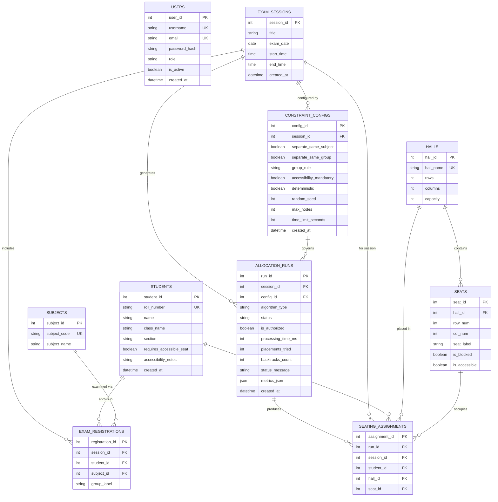

# Database Architecture & Entity Relationships

This document describes the PostgreSQL database schema for the **Automated Examination Hall Allotment and Seating Arrangement System** and explains how all 10 tables connect to one another.

---

## Entity-Relationship (ER) Diagram

---

## Plain-English Explanation of Entities & Relationships

1. **`users`**
   - Stores authorized administrator accounts (login credentials stored as secure password hashes, never plaintext) and roles.
   - Standalone table used for authentication and protecting administrative routes.

2. **`students`**
   - Stores every student's unique `roll_number`, `name`, `class_name`, `section`, and accessibility requirement (`requires_accessible_seat`).
   - By default, a student's configured group is `class_name + "-" + section` (for example, `CS-A`).

3. **`subjects`** and **`exam_sessions`** connected through **`exam_registrations`**
   - An **Exam Session** is one scheduled exam time slot (date + start time), such as *"Midterm Morning Slot"*.
   - Multiple **Subjects** can be examined simultaneously during the same **Exam Session** (so students from different subjects can share halls and sit beside one another safely).
   - **`exam_registrations`** resolves the Many-to-Many relationship: it records *which student* is sitting *which exam session* for *which subject*, plus their resolved `group_label`. A unique rule on `(session_id, student_id)` ensures a student cannot accidentally be registered twice for the same time slot.

4. **`halls`** and **`seats`** *(1-to-Many)*
   - One **Hall** contains many **Seats** arranged in a `rows × columns` grid.
   - Each seat has exact `(row_num, col_num)` coordinates (needed so the seating engine can check **Left, Right, Front, and Back** orthogonal neighbors), plus `is_blocked` (never assigned) and `is_accessible` (prioritized for special-needs students).
   - A unique constraint on `(hall_id, row_num, col_num)` guarantees no duplicate seat coordinates exist in a hall.

5. **`constraint_configs`** *(Many-to-1 with `exam_sessions`)*
   - Stores the exact rules used for an exam session: whether same-subject and same-group separation are active, the grouping rule (`class_section` by default), whether accessibility is mandatory, deterministic vs. seeded execution, and backtracking node/time limits.

6. **`allocation_runs`** and **`seating_assignments`** *(1-to-Many)*
   - Every time an administrator runs **Backtracking (MRV + Forward Checking)** or **Greedy First-Fit** (or optional CP-SAT), one **`allocation_runs`** record is saved with its status (`feasible`, `infeasible`, `inconclusive`, or `capacity_shortfall`), runtime, placements tried, backtracks count, and evaluation metrics.
   - Keeping runs separate lets you **compare Backtracking vs. Greedy side-by-side** on the exact same exam session without overwriting either result, and mark the chosen plan `is_authorized = True`.
   - **`seating_assignments`** stores the individual `(student_id, hall_id, seat_id)` placements for a specific `run_id`. Two database uniqueness rules (`(run_id, student_id)` and `(run_id, seat_id)`) enforce at the database level that **each student gets at most 1 seat** and **each seat holds at most 1 student** in any run.
